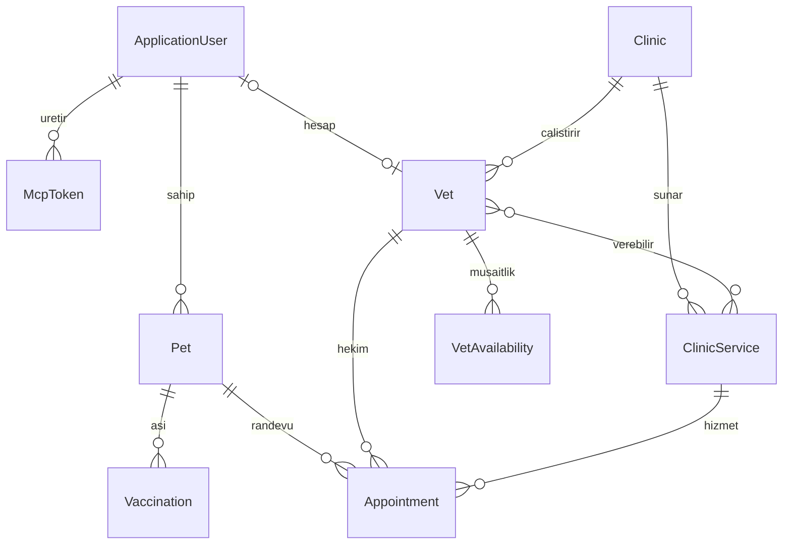

# Veteriner Kliniği Randevu ve Hasta Takip Sistemi

- **Öğrenci No:** B241210084
- **Ad Soyad:** Burak Kahveci
- **Ders Grubu:** DERS_GRUBUNU_YAZ
- **GitHub:** https://github.com/TheJeynn/VetKlinik

ASP.NET Core MVC (.NET 10) ile geliştirilen; randevu, hasta (evcil hayvan) ve aşı takibi yapan, REST API ve MCP sunucusu içeren bir veteriner kliniği sistemidir.

## Teknolojiler
.NET 10, ASP.NET Core MVC, Entity Framework Core (Code First, Migration), SQLite, ASP.NET Core Identity, Bootstrap 5, jQuery, Model Context Protocol C# SDK.

## Çalıştırma
    dotnet run
Veritabanı (`vet.db`) migration ile otomatik oluşur ve örnek veri yüklenir. Adres: `https://localhost:7053`

| Rol | E-posta | Parola |
|---|---|---|
| Admin | b241210084@sakarya.edu.tr | sau |
| Veteriner | veteriner@vet.com | sau |
| Üye | uye@vet.com | sau |

Yeni kullanıcılar **Kayıt Ol** ile `Uye` rolüyle oluşur. Admin, **Yönetim → Kullanıcılar** ekranından rol değiştirir.

## Veri Modeli (ER Diyagramı)

## İş Kuralları
- **Randevu çakışması:** Hizmet süresi dahil, aynı hekimin başka randevusuyla kesişen saatlere randevu verilmez (`BookingService.CheckAsync`).
- Randevu klinik çalışma saati ve hekimin müsaitlik aralığı içinde olmalıdır, geçmiş tarihe alınamaz.
- Hekimin verdiği hizmet dışında randevu alınamaz.
- Randevu "Bekliyor" olarak açılır; Admin/Veteriner onaylar veya neden belirterek reddeder. Süre ve ücret randevu anında kaydedilir.
- Tüm doğrulama kuralları tek serviste (`BookingService`) toplanmıştır; MVC, REST API ve MCP aynı servisi kullanır.

## Yetkilendirme
| Rol | Yetkiler |
|---|---|
| Üye | Kendi hayvanlarını ve randevularını görür/yönetir; bekleyen randevusunu iptal eder |
| Veteriner | Kendi randevularını onaylar/reddeder, muayene notu ve aşı girer, tüm hayvanları görür |
| Admin | Klinik, hizmet, veteriner yönetimi; kullanıcı ve rol yönetimi; yönetim paneli (istatistik, gelir) |

Üye, başka kullanıcının kaydına Id ile erişmeye çalışırsa 404 alır (sahiplik kontrolü sunucu tarafındadır).

## REST API
Kimlik: oturum çerezi veya `Authorization: Bearer <token>` (token: menüdeki anahtar simgesi).

| Metot | Adres | Açıklama | Kodlar |
|---|---|---|---|
| GET | /api/services?q=&maxPrice= | Hizmet listesi (herkese açık) | 200 |
| GET | /api/vets?serviceId= | Veterinerler (herkese açık) | 200 |
| GET | /api/slots?serviceId=&date=yyyy-MM-dd | Boş saatler (herkese açık) | 200, 400, 404 |
| GET | /api/pets, /api/pets/{id} | Hayvanlar (sahibine özel) | 200, 401, 404 |
| GET | /api/pets/{id}/vaccines | Aşı takvimi | 200, 401, 404 |
| GET | /api/appointments?status=&from=&to= | Randevular (rolüne göre) | 200, 401 |
| GET | /api/appointments/{id} | Randevu detayı | 200, 404 |
| POST | /api/appointments | Randevu oluşturur | 201, 400, 401, 404 |
| PATCH | /api/appointments/{id}/status | Onay/red (Admin, Veteriner) | 200, 400, 403, 404 |
| GET | /api/reports/revenue | Hizmet bazlı gelir (Admin) | 200, 403 |

Örnek istek:

    POST /api/appointments
    {"petId":1,"clinicServiceId":1,"vetId":1,"start":"2026-12-01T10:00:00"}

    201 Created
    {"id":3,"pet":"Pamuk","service":"Muayene","vet":"Dr. Ayşe Demir","start":"2026-12-01T10:00:00","end":"2026-12-01T10:30:00","price":500.0,"status":"Bekliyor","rejectReason":null}

Çakışmada `400 {"message":"Hekimin 10:00-10:30 arasında başka randevusu var."}` döner.

## MCP Sunucusu
Adres: `/mcp` (Streamable HTTP). Her istek `Authorization: Bearer <token>` ile yetkilendirilir; araçlar yalnızca token sahibinin verisini kullanır.

| Araç | Tür | Açıklama |
|---|---|---|
| hizmetleri_listele | okuma | Hizmet, süre ve ücretler |
| uygun_saatler | okuma | Verilen gün ve hizmet için boş hekim/saatler |
| asi_takvimi | okuma | Kullanıcının hayvanının geçmiş ve yaklaşan aşıları |
| randevu_olustur | **yazma** | Randevu oluşturur, çakışmada nedenini söyler |

Token üretme: giriş yap, menüdeki anahtar simgesi, **Yeni token üret**. Test için MCP Inspector kullanılabilir.

## Ekran Görüntüleri
(ekran görüntüleri eklenecek)

## Geliştirme Notları
- SQLite `decimal` toplamayı desteklemediği için gelir gruplaması bellekte yapılır.
- Parola kuralları ödev gereği (`sau`) gevşetilmiştir.